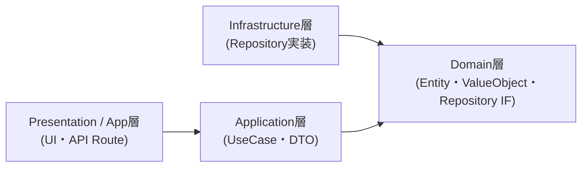
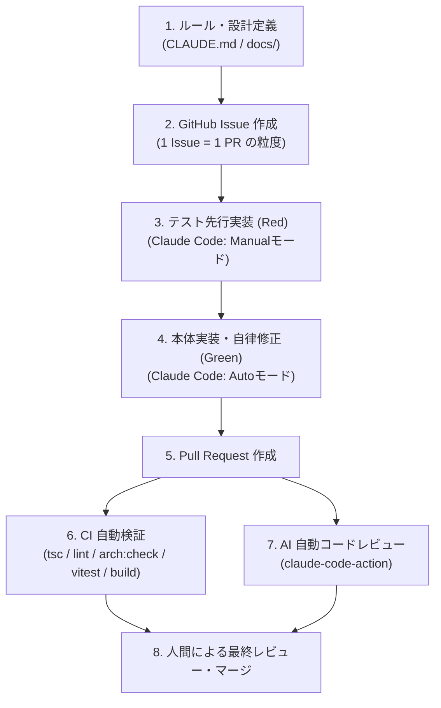

# 勤怠管理システム（AI駆動開発 × DDD 実践プロジェクト）

Claude Code と GitHub Actions を組み合わせ、**「要件・設計の言語化 → テスト駆動開発（TDD） → 機械的なアーキテクチャ境界チェック → AI自動PRレビュー」**という企業レベルのAI駆動開発（AIDD）ワークフローを実践・検証した勤怠管理システムです[cite: 2, 5, 7]。

---

## 主な機能（MVP）

* **出勤・退勤打刻:** 従業員ID（`x-employee-id` ヘッダ / デフォルト `emp-001`）ごとの打刻処理[cite: 4]
* **ドメインルールのカプセル化:**
  * 退勤時刻が出勤時刻より前になる不正データの防止[cite: 4]
  * 同一営業日における「出勤中（未退勤）」状態での二重打刻防止[cite: 4]
  * 休憩時間を差し引いた実働時間および所定労働時間（8時間）超過分の残業時間自動計算[cite: 4]
* **勤怠履歴一覧表示:** 当日の打刻ステータス操作および過去の勤怠実績・残業時間の確認[cite: 2]

---

## 技術スタック

| カテゴリ | 採用技術 | 選定意図 |
| :--- | :--- | :--- |
| **言語** | TypeScript (strict mode) | 静的型検査をAIの自律デバッグ（自己修正ループ）のフィードバックとして活用[cite: 5] |
| **フレームワーク** | Next.js (App Router) | フロントエンド（UI）とバックエンド（API Route）の統一的な開発[cite: 4, 5] |
| **テスト** | Vitest | ドメイン層の単体テストからAPI・プレゼンテーション層のテストまで高速実行[cite: 2, 5] |
| **境界チェック** | dependency-cruiser | DDDの依存ルール違反を静的解析で検知し、CIで自動ブロック[cite: 5, 9] |
| **CI / CD・AI連携** | GitHub Actions / Claude Code | テスト・型・境界チェックの自動化および `claude-code-action` によるPR自動レビュー[cite: 5, 6, 7] |

---

## アーキテクチャ設計（DDD レイヤードアーキテクチャ）

依存の方向を **「外側 → 内側」の一方向のみ** に制限し、`domain` 層をフレームワークやDBから完全に独立させています[cite: 4]。



* ルール定義: [`CLAUDE.md`](./CLAUDE.md)
* 境界チェック設定: [`.dependency-cruiser.cjs`](./.dependency-cruiser.cjs)
* 設計判断の記録（ADR）: [`docs/adr/001-use-ddd-layered-architecture.md`](./docs/adr/001-use-ddd-layered-architecture.md)

---

## AI駆動開発（AIDD）ワークフロー

AIの出力品質を安定させるため、人間が上流のルールと設計を定義し、ツールとCIが品質ゲートを担うフローを構築しています[cite: 5]。



---

## セットアップ・実行手順

```bash
# 依存パッケージのインストール
npm install

# 開発サーバーの起動（http://localhost:3000）
npm run dev

# 各種品質チェックの実行
npx next typegen && npx tsc --noEmit  # 型チェック
npm run arch:check                    # DDDアーキテクチャ境界チェック
npx vitest run                        # 単体・結合テスト
npm run lint                          # Lintチェック
```