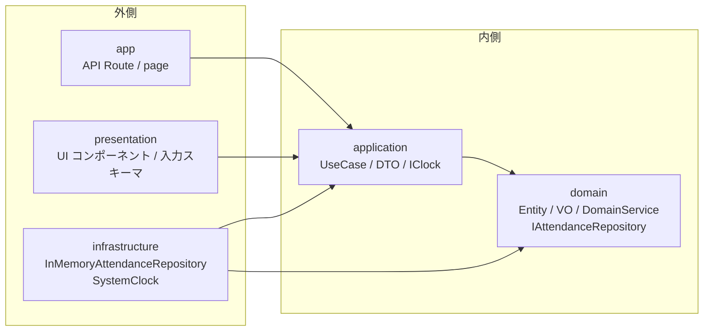
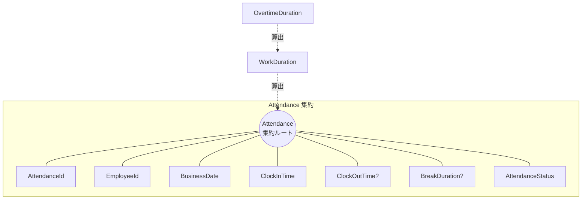
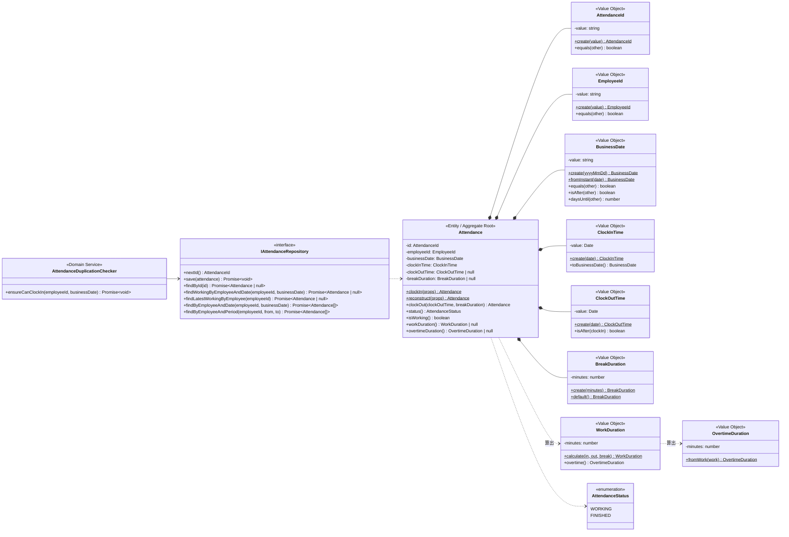
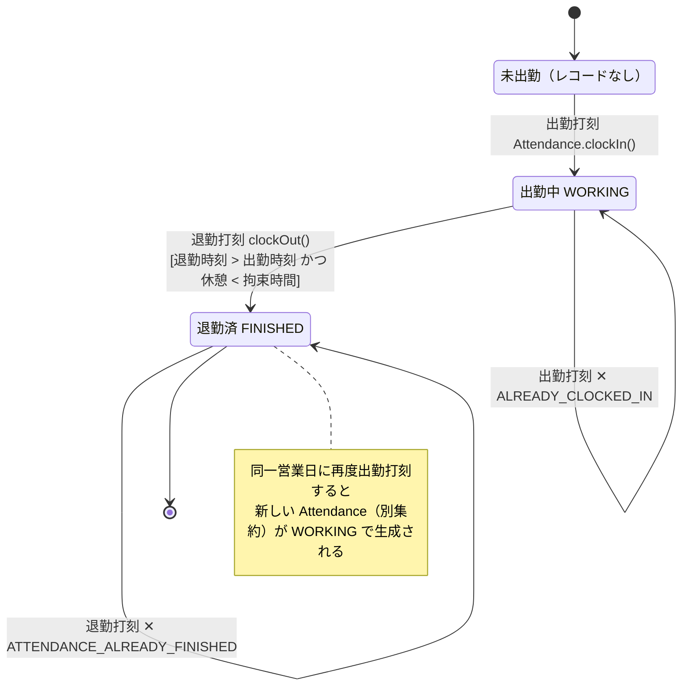
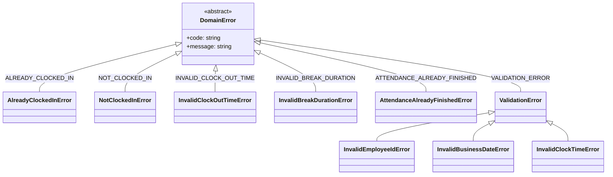
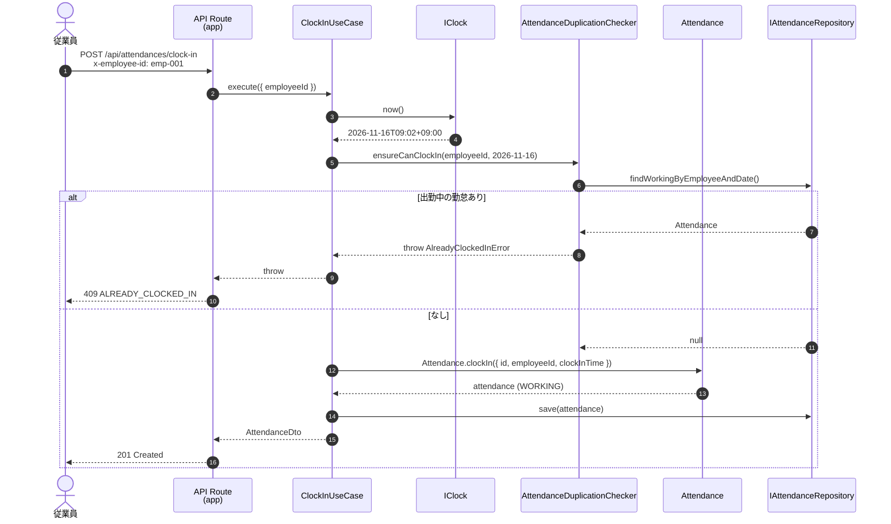
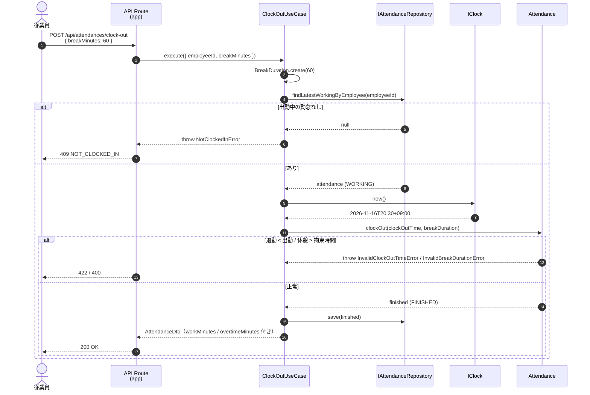
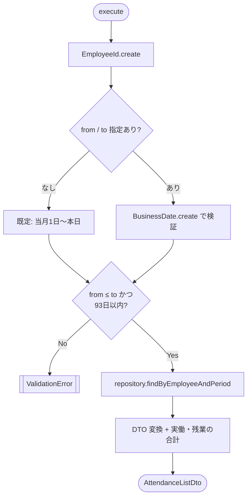

# ドメインモデル設計書 — 勤怠管理システム

| 項目 | 内容 |
| --- | --- |
| 版数 | v0.1（初期フェーズ / MVP） |
| 関連ドキュメント | [要件定義書](./requirements.md) / [CLAUDE.md](../CLAUDE.md) |
| 対象層 | `src/domain`（中心）、`src/application` |

本書は [要件定義書](./requirements.md) の業務ルール（BR-01〜05）を **どのモデルがどう守るか** を定義する。
実装はこの設計に従い、TDD（テスト先行）で行う。

---

## 1. 設計方針

| # | 方針 | 狙い |
| --- | --- | --- |
| D-1 | 業務ルールはすべて `domain` 層の値オブジェクト・エンティティ・ドメインサービスに置く | UI や API を経由しない呼び出しでもルールが破られない |
| D-2 | `domain` 層は純粋な TypeScript のみ（外部ライブラリ・Next.js・他層への依存なし） | フレームワーク非依存で高速に単体テストできる |
| D-3 | 値オブジェクトは **不変** とし、生成時（`create`）にバリデーションする | 不正な値が存在し得ない状態を型で保証する（"Always Valid"） |
| D-4 | エンティティの状態変更メソッドは **新しいインスタンスを返す** | 共有参照による意図しない変更を防ぎ、テストを単純にする |
| D-5 | 現在時刻は `IClock` から取得し、ドメインは時刻を引数で受け取る | 「09:00 に出勤」などの時刻依存ルールを決定的にテストできる |
| D-6 | 永続化は `domain` 層の `IAttendanceRepository` 越しに行う | InMemory → Prisma の差し替えでドメインに影響を出さない |

### 1.1 レイヤー構成と依存方向



依存は常に外側から内側への一方向。この制約は `.dependency-cruiser.cjs` で定義され、`npm run arch:check` で機械的に検証する。

---

## 2. ユビキタス言語（用語定義）

コード上の名前と業務上の言葉を一致させる。チーム（および AI エージェント）は以下の用語のみを使う。

| 用語 | 英語名（コード） | 型 | 定義 |
| --- | --- | --- | --- |
| 従業員ID | `EmployeeId` | 値オブジェクト | 従業員を一意に識別する文字列。MVP では `x-employee-id` ヘッダ、または既定値 `emp-001`。 |
| 勤怠 | `Attendance` | エンティティ（集約ルート） | 1 回の「出勤〜退勤」を表すレコード。同一営業日に複数存在し得る。 |
| 勤怠ID | `AttendanceId` | 値オブジェクト | 勤怠を一意に識別する ID。 |
| 営業日 | `BusinessDate` | 値オブジェクト | 勤怠が帰属する日付。**出勤時刻の JST 日付** で決まり、退勤が翌日になっても変わらない。 |
| 出勤時刻 | `ClockInTime` | 値オブジェクト | 出勤打刻を行った時刻。 |
| 退勤時刻 | `ClockOutTime` | 値オブジェクト | 退勤打刻を行った時刻。出勤時刻より後でなければならない。 |
| 拘束時間 | （`ClockOutTime − ClockInTime`） | 計算値 | 出勤から退勤までの経過時間。休憩を含む。 |
| 休憩時間 | `BreakDuration` | 値オブジェクト | 拘束時間のうち労働しなかった時間（分）。0 以上かつ拘束時間未満。 |
| 実働時間 | `WorkDuration` | 値オブジェクト | 拘束時間 − 休憩時間（分）。 |
| 所定労働時間 | `STANDARD_WORK_MINUTES` | 定数 | 1 勤怠あたりの基準労働時間。**480 分（8 時間）**。 |
| 残業時間 | `OvertimeDuration` | 値オブジェクト | 実働時間のうち所定労働時間を超えた分。超えなければ 0。 |
| 勤怠ステータス | `AttendanceStatus` | 値オブジェクト（列挙） | `WORKING`（出勤中）/ `FINISHED`（退勤済）。 |
| 当日ステータス | `TodayStatus` | DTO 上の列挙 | 画面表示用。勤怠ステータスに `NOT_STARTED`（未出勤）を加えたもの。 |
| 打刻 | Clock in / Clock out | 操作 | 出勤・退勤の時刻を記録する行為。 |

> 「未出勤」は **勤怠レコードが存在しない状態** であり、`Attendance` 自体はこの状態を持たない（存在しないものにステータスは付けられないため）。当日の状況確認ユースケースが「レコードなし」を `NOT_STARTED` に変換する。

---

## 3. 集約・エンティティ・値オブジェクト

### 3.1 集約の境界



- **集約ルートは `Attendance` のみ**。1 集約 = 1 回の出勤〜退勤。
- `EmployeeId` は従業員集約（MVP では未実装）への **ID 参照** であり、従業員オブジェクトは保持しない。
- `WorkDuration` / `OvertimeDuration` は保存せず、退勤時刻と休憩時間から **都度算出** する（保存値と計算値の不整合を防ぐ）。
- 「同一営業日に出勤中は 1 件まで」（BR-02）は **複数の集約にまたがる** ルールのため、エンティティ単体では守れない。これはドメインサービス（§4）が担う。

### 3.2 クラス図



### 3.3 勤怠ステータスの状態遷移



- ステータスはフィールドとして保持せず、**`clockOutTime` の有無から導出** する（`null` → `WORKING`、値あり → `FINISHED`）。状態と時刻が食い違う不正状態をそもそも作れないようにするため。
- `FINISHED` は終端状態。打刻修正は MVP の対象外。

### 3.4 エンティティ: `Attendance`（集約ルート）

**プロパティ**

| プロパティ | 型 | 必須 | 説明 |
| --- | --- | --- | --- |
| `id` | `AttendanceId` | ✅ | 識別子。同一性はこの値のみで判定する |
| `employeeId` | `EmployeeId` | ✅ | 打刻した従業員 |
| `businessDate` | `BusinessDate` | ✅ | 出勤時刻から決定。以後不変 |
| `clockInTime` | `ClockInTime` | ✅ | 出勤時刻 |
| `clockOutTime` | `ClockOutTime \| null` | — | 退勤時刻。出勤中は `null` |
| `breakDuration` | `BreakDuration \| null` | — | 休憩時間。退勤時に確定。出勤中は `null` |

**メソッドと責務**

| メソッド | 種別 | 責務 | 例外 |
| --- | --- | --- | --- |
| `static clockIn({ id, employeeId, clockInTime })` | ファクトリ | 出勤中の勤怠を新規生成する。`businessDate` は `clockInTime.toBusinessDate()` で決める | — |
| `static reconstruct(props)` | ファクトリ | リポジトリから復元する。**全不変条件を再検証** する | 不整合時に `DomainError` |
| `clockOut(clockOutTime, breakDuration)` | コマンド | 退勤を記録した **新しい** `Attendance` を返す。① 出勤中であること ② 退勤時刻 > 出勤時刻（BR-01）③ 休憩 < 拘束時間（BR-04）を検証 | `AttendanceAlreadyFinishedError` / `InvalidClockOutTimeError` / `InvalidBreakDurationError` |
| `status()` | クエリ | `clockOutTime` の有無から `WORKING` / `FINISHED` を返す | — |
| `isWorking()` | クエリ | `status() === WORKING` | — |
| `workDuration()` | クエリ | 退勤済なら `WorkDuration.calculate(...)`、出勤中なら `null`（BR-03） | — |
| `overtimeDuration()` | クエリ | `workDuration()?.overtime()` | — |

**不変条件（常に真であること）**

1. `clockOutTime` と `breakDuration` は **両方 `null`** か **両方値あり** のどちらか。
2. `clockOutTime` が存在するなら `clockOutTime > clockInTime`。
3. `breakDuration` が存在するなら `breakDuration < (clockOutTime − clockInTime)`。
4. `businessDate === clockInTime.toBusinessDate()`。

### 3.5 値オブジェクト

すべて `private constructor` + `static create()` で生成し、生成時にバリデーションする。プロパティは `readonly`。等価性は値で判定する（`equals`）。

| 値オブジェクト | 内部値 | 生成条件（バリデーション） | 主なメソッド | 違反時の例外 |
| --- | --- | --- | --- | --- |
| `EmployeeId` | `string` | 前後の空白を除去後、1〜64 文字、`^[A-Za-z0-9_-]+$` | `equals`, `toString` | `InvalidEmployeeIdError` |
| `AttendanceId` | `string` | 空文字でないこと | `equals`, `toString` | `DomainError` |
| `BusinessDate` | `string`（`YYYY-MM-DD`） | 形式が正しく、暦上存在する日付（`2026-02-30` は不可） | `fromInstant(date)`：JST 日付に変換 / `equals` / `isAfter` / `daysUntil` | `InvalidBusinessDateError` |
| `ClockInTime` | `Date`（防御的コピー） | 有効な日時（`Invalid Date` でない） | `toBusinessDate()` / `toDate()` | `InvalidClockTimeError` |
| `ClockOutTime` | `Date`（防御的コピー） | 有効な日時 | `isAfter(clockIn)` / `minutesSince(clockIn)` / `toDate()` | `InvalidClockTimeError` |
| `BreakDuration` | `number`（分） | 0 以上の整数 | `default()`：60 分 / `minutes` | `InvalidBreakDurationError` |
| `WorkDuration` | `number`（分） | 0 以上の整数 | `calculate(in, out, break)` / `overtime()` / `minutes` | `DomainError` |
| `OvertimeDuration` | `number`（分） | 0 以上の整数 | `fromWork(work)` / `minutes` | `DomainError` |
| `AttendanceStatus` | `'WORKING' \| 'FINISHED'` | 列挙値のみ | — | — |

**計算ロジック（BR-03）**

```text
拘束分  = floor((clockOut − clockIn) / 60,000ms)      ※ 秒以下は切り捨て
実働分  = 拘束分 − 休憩分                              → WorkDuration.calculate
残業分  = max(0, 実働分 − STANDARD_WORK_MINUTES(480))  → OvertimeDuration.fromWork
```

**`BusinessDate.fromInstant` の JST 変換**

外部ライブラリを使わず、UTC ミリ秒に `+9h` を加えた上で `getUTCFullYear / getUTCMonth / getUTCDate` から `YYYY-MM-DD` を組み立てる。実行環境のタイムゾーン設定に依存しない。

> **なぜ「退勤時刻 > 出勤時刻」を `ClockOutTime` 単体で検証しないのか**
> `ClockOutTime` 単体では比較対象の出勤時刻を知らない。比較に必要な情報が揃うのは `Attendance.clockOut()` の時点であるため、ルールは集約ルートが守る。`ClockOutTime` は比較手段（`isAfter`）だけを提供する。

### 3.6 ドメイン例外

`DomainError` を基底クラスとし、各例外は **機械可読なエラーコード** を持つ。HTTP ステータスへの変換は `app` 層で行う（[要件定義書 §5.3](./requirements.md#53-エラーコード一覧)）。



---

## 4. ドメインサービス

### 4.1 `AttendanceDuplicationChecker`（二重打刻の防止 / BR-02）

| 項目 | 内容 |
| --- | --- |
| 配置 | `src/domain/services/AttendanceDuplicationChecker.ts` |
| 依存 | `IAttendanceRepository`（コンストラクタ注入） |
| メソッド | `ensureCanClockIn(employeeId: EmployeeId, businessDate: BusinessDate): Promise<void>` |
| 振る舞い | `findWorkingByEmployeeAndDate` が勤怠を返したら `AlreadyClockedInError` を投げる。`null` なら何もしない |
| ドメインサービスにする理由 | 「他の勤怠レコードの存在」に依存するルールで、新しく生成される `Attendance` 自身は判定に必要な情報を持たないため |

> **同時実行について**: チェックと保存の間に別リクエストが割り込む可能性（TOCTOU）がある。MVP のインメモリ実装は単一プロセスのため許容する。Prisma 実装では DB 側に **部分ユニーク制約**（`UNIQUE(employee_id, business_date) WHERE clock_out_at IS NULL`）を設け、最終防衛線とする。

### 4.2 業務ルールと責務の対応表

| ルール | 守る場所 | 検証タイミング |
| --- | --- | --- |
| BR-01 退勤 > 出勤 | `Attendance.clockOut()`（`ClockOutTime.isAfter` を利用） | 退勤時 |
| BR-02 二重打刻防止 | `AttendanceDuplicationChecker.ensureCanClockIn()` | 出勤時 |
| BR-02 退勤済への再退勤禁止 | `Attendance.clockOut()` | 退勤時 |
| BR-03 実働・残業計算 | `WorkDuration.calculate()` / `OvertimeDuration.fromWork()` | 参照時（都度算出） |
| BR-04 休憩の形式 | `BreakDuration.create()` | 値の生成時 |
| BR-04 休憩 < 拘束時間 | `Attendance.clockOut()` | 退勤時 |
| BR-05 従業員 ID の形式 | `EmployeeId.create()` | 値の生成時 |
| BR-05 ヘッダ省略時の既定値 | `app` 層（API Route） | リクエスト受信時 |

> BR-05 の「既定値 `emp-001`」は認証の仮置きであり業務ルールではないため、ドメインには置かない。認証導入時に `app` 層だけを差し替えられるようにする。

---

## 5. リポジトリインターフェース

### 5.1 `IAttendanceRepository`

配置: `src/domain/repositories/IAttendanceRepository.ts`（インターフェースは **domain 層**、実装は infrastructure 層）

```ts
export interface IAttendanceRepository {
  nextId(): AttendanceId;
  save(attendance: Attendance): Promise<void>;
  findById(id: AttendanceId): Promise<Attendance | null>;
  findWorkingByEmployeeAndDate(employeeId: EmployeeId, businessDate: BusinessDate): Promise<Attendance | null>;
  findLatestWorkingByEmployee(employeeId: EmployeeId): Promise<Attendance | null>;
  findByEmployeeAndDate(employeeId: EmployeeId, businessDate: BusinessDate): Promise<Attendance[]>;
  findByEmployeeAndPeriod(employeeId: EmployeeId, from: BusinessDate, to: BusinessDate): Promise<Attendance[]>;
}
```

| メソッド | 用途 | 返り値・並び順 | 利用元 |
| --- | --- | --- | --- |
| `nextId()` | 新しい勤怠 ID を払い出す（ID 生成戦略を永続化側に委ねる） | `AttendanceId` | `ClockInUseCase` |
| `save(attendance)` | 新規作成・更新（upsert）。`id` で同一性を判定 | — | `ClockInUseCase`, `ClockOutUseCase` |
| `findById(id)` | ID で 1 件取得 | 該当なしは `null` | テスト・将来の修正機能 |
| `findWorkingByEmployeeAndDate(e, d)` | 指定営業日の **出勤中** 勤怠を取得 | 該当なしは `null` | `AttendanceDuplicationChecker` |
| `findLatestWorkingByEmployee(e)` | 営業日を問わず、最も新しい **出勤中** 勤怠を取得（日付またぎ退勤に対応） | 出勤時刻が最新の 1 件、なしは `null` | `ClockOutUseCase` |
| `findByEmployeeAndDate(e, d)` | 指定営業日の勤怠をすべて取得 | 出勤時刻の昇順 | `GetTodayAttendanceUseCase` |
| `findByEmployeeAndPeriod(e, from, to)` | 期間内（両端含む）の勤怠を取得 | 営業日の降順 → 出勤時刻の降順 | `GetAttendanceListUseCase` |

**設計上のポイント**

- 引数・返り値は **ドメインオブジェクトのみ**。プリミティブや DB の行型を漏らさない。
- インメモリ実装はエンティティを保持する際に参照を共有しない（D-4 の不変設計により、保存したインスタンスが外部から書き換わることはない）。
- 復元時は `Attendance.reconstruct()` を通すため、DB に不正なデータがあっても不変条件違反として検出できる。

### 5.2 `IClock`（アプリケーション層のポート）

| 項目 | 内容 |
| --- | --- |
| 配置 | `src/application/ports/IClock.ts` |
| 定義 | `interface IClock { now(): Date }` |
| 実装 | `src/infrastructure/clock/SystemClock.ts`（`new Date()`）、テストでは `FixedClock` |
| 理由 | 「今」を決めるのは業務ではなくシステムの関心事。ドメインは時刻を引数で受け取るだけにし、ユースケースが `IClock` から取得して渡す |

---

## 6. ユースケース

すべて `src/application/usecases/` に配置し、`execute(input): Promise<output>` の単一メソッドを持つ。
依存（リポジトリ・時計・ドメインサービス）はコンストラクタで注入し、組み立て（DI）は `app` 層で行う。

| ユースケース | 機能 | 入力 DTO | 出力 DTO | 更新 |
| --- | --- | --- | --- | --- |
| `ClockInUseCase` | F-01 出勤打刻 | `ClockInInput` | `AttendanceDto` | ✅ |
| `ClockOutUseCase` | F-02 退勤打刻 | `ClockOutInput` | `AttendanceDto` | ✅ |
| `GetAttendanceListUseCase` | F-04 履歴一覧 | `GetAttendanceListInput` | `AttendanceListDto` | — |
| `GetTodayAttendanceUseCase` | F-03 当日の状況（補助） | `GetTodayAttendanceInput` | `TodayAttendanceDto` | — |

### 6.1 DTO 定義

DTO は **プリミティブ型のみ** で構成し、ドメインオブジェクトを層の外へ漏らさない。日時は JST オフセット付き ISO 8601 文字列。

```ts
// ---- 入力 ----
type ClockInInput            = { employeeId: string };
type ClockOutInput           = { employeeId: string; breakMinutes?: number };
type GetAttendanceListInput  = { employeeId: string; from?: string; to?: string }; // YYYY-MM-DD
type GetTodayAttendanceInput = { employeeId: string };

// ---- 出力 ----
type AttendanceDto = {
  id: string;
  employeeId: string;
  businessDate: string;          // "2026-11-14"
  clockInAt: string;             // "2026-11-14T09:00:00+09:00"
  clockOutAt: string | null;
  breakMinutes: number | null;
  workMinutes: number | null;
  overtimeMinutes: number | null;
  status: 'WORKING' | 'FINISHED';
};

type TodayAttendanceDto = {
  businessDate: string;
  status: 'NOT_STARTED' | 'WORKING' | 'FINISHED';
  attendance: AttendanceDto | null;   // 当日の最新の勤怠
};

type AttendanceListDto = {
  from: string;
  to: string;
  items: AttendanceDto[];             // 営業日の降順
  totalWorkMinutes: number;           // 退勤済のみ集計
  totalOvertimeMinutes: number;
};
```

エンティティから `AttendanceDto` への変換は `AttendanceDtoMapper.toDto(attendance)`（application 層）に集約する。

### 6.2 `ClockInUseCase`（出勤打刻）

| ステップ | 処理 | 担当 |
| --- | --- | --- |
| 1 | `EmployeeId.create(input.employeeId)` | VO（形式不正 → `InvalidEmployeeIdError`） |
| 2 | `now = clock.now()` → `ClockInTime.create(now)` → `businessDate = clockInTime.toBusinessDate()` | IClock / VO |
| 3 | `duplicationChecker.ensureCanClockIn(employeeId, businessDate)` | ドメインサービス（BR-02） |
| 4 | `Attendance.clockIn({ id: repository.nextId(), employeeId, clockInTime })` | エンティティ |
| 5 | `repository.save(attendance)` | リポジトリ |
| 6 | `AttendanceDtoMapper.toDto(attendance)` を返す | Mapper |



### 6.3 `ClockOutUseCase`（退勤打刻）

| ステップ | 処理 | 担当 |
| --- | --- | --- |
| 1 | `EmployeeId.create(input.employeeId)` | VO |
| 2 | `breakDuration = input.breakMinutes === undefined ? BreakDuration.default() : BreakDuration.create(input.breakMinutes)` | VO（BR-04 形式） |
| 3 | `current = repository.findLatestWorkingByEmployee(employeeId)`。`null` なら `NotClockedInError` | リポジトリ（BR-02） |
| 4 | `clockOutTime = ClockOutTime.create(clock.now())` | IClock / VO |
| 5 | `finished = current.clockOut(clockOutTime, breakDuration)` | エンティティ（BR-01, BR-04） |
| 6 | `repository.save(finished)` | リポジトリ |
| 7 | `AttendanceDtoMapper.toDto(finished)` を返す（実働・残業を含む） | Mapper（BR-03） |



> **退勤対象を「営業日」ではなく「最新の出勤中勤怠」で探す理由**: 22:00 出勤 → 翌 06:00 退勤のような日付またぎ勤務では、退勤時点の日付で検索すると対象が見つからないため（AC-01-4）。
> なお、前日に退勤し忘れたまま当日出勤した場合、前日分は出勤中のまま残る。この是正は打刻修正機能（MVP 対象外）で扱う。

### 6.4 `GetAttendanceListUseCase`（勤怠履歴一覧）

| ステップ | 処理 | 担当 |
| --- | --- | --- |
| 1 | `EmployeeId.create(input.employeeId)` | VO |
| 2 | `today = BusinessDate.fromInstant(clock.now())` | IClock / VO |
| 3 | `from = input.from ? BusinessDate.create(input.from) : 当月 1 日`、`to = input.to ? BusinessDate.create(input.to) : today` | VO（形式不正 → `InvalidBusinessDateError`） |
| 4 | `from > to`、または期間が 93 日を超える場合は `ValidationError` | ユースケース（入力条件） |
| 5 | `attendances = repository.findByEmployeeAndPeriod(employeeId, from, to)` | リポジトリ |
| 6 | 各勤怠を DTO に変換し、退勤済の `workMinutes` / `overtimeMinutes` を合計 | Mapper |
| 7 | `AttendanceListDto` を返す | — |



> 期間上限（93 日）は業務ルールではなく **システム保護のための入力制約** のため、ドメインではなくユースケースに置く。

### 6.5 `GetTodayAttendanceUseCase`（当日の状況 / 補助）

F-03 のための読み取り専用ユースケース。`today = BusinessDate.fromInstant(clock.now())` で `findByEmployeeAndDate` を呼び、結果を次のように `TodayAttendanceDto` に変換する。

| 当日の勤怠 | `status` | `attendance` |
| --- | --- | --- |
| 0 件 | `NOT_STARTED` | `null` |
| 最新が出勤中 | `WORKING` | 最新の勤怠 |
| 最新が退勤済 | `FINISHED` | 最新の勤怠 |

---

## 7. ファイル配置

| 層 | パス | 内容 |
| --- | --- | --- |
| domain | `src/domain/models/attendance/Attendance.ts` | エンティティ |
| domain | `src/domain/models/attendance/AttendanceId.ts` ほか | 値オブジェクト（`EmployeeId`, `BusinessDate`, `ClockInTime`, `ClockOutTime`, `BreakDuration`, `WorkDuration`, `OvertimeDuration`, `AttendanceStatus`） |
| domain | `src/domain/services/AttendanceDuplicationChecker.ts` | ドメインサービス |
| domain | `src/domain/repositories/IAttendanceRepository.ts` | リポジトリ IF |
| domain | `src/domain/errors/*.ts` | `DomainError` と派生例外 |
| application | `src/application/usecases/*UseCase.ts` | ユースケース 4 種 |
| application | `src/application/dto/*.ts` | 入出力 DTO・`AttendanceDtoMapper` |
| application | `src/application/ports/IClock.ts` | 時計ポート |
| infrastructure | `src/infrastructure/repositories/InMemoryAttendanceRepository.ts` | リポジトリ実装（MVP） |
| infrastructure | `src/infrastructure/clock/SystemClock.ts` | 時計実装 |
| app | `src/app/api/attendances/**/route.ts` | API Route（DI・ヘッダ解決・例外 → HTTP 変換） |
| presentation | `src/presentation/components/*.tsx` | 打刻エリア・勤怠一覧テーブル |

テストは対象ファイルと同じディレクトリに `*.test.ts` として配置する。

---

## 8. テスト方針（TDD）

| 対象 | テストの種類 | 主な観点 | 依存の扱い |
| --- | --- | --- | --- |
| 値オブジェクト | 単体 | 生成条件の境界値（`BreakDuration(-1)` / `(0)`、存在しない日付、JST の日付境界 23:59/00:00） | なし |
| `Attendance` | 単体 | 状態遷移、BR-01・BR-04 の異常系、AC-03 の計算表、`reconstruct` の不変条件検証 | なし |
| `AttendanceDuplicationChecker` | 単体 | AC-02-1〜4 | `InMemoryAttendanceRepository` |
| ユースケース | 単体（結合寄り） | 正常系・異常系の入出力、DTO の内容 | `InMemoryAttendanceRepository` + `FixedClock` |
| API Route | 結合（後続フェーズ） | HTTP ステータスとエラーコードの変換、ヘッダ既定値（BR-05） | — |

要件定義書の受け入れ条件 ID（`AC-xx-x`）をテスト名に含め、要件とテストの対応を追跡できるようにする。

```ts
it('AC-03-2: 09:00〜20:30・休憩60分なら実働630分・残業150分', () => { /* ... */ });
```
